# Manual de usuario — AutoInfra

## 1. Introducción

AutoInfra es una aplicación web para editar archivos con extensión `.infra`, analizarlos y **ejecutarlos** (simulación de infraestructura) mediante un Backend de Node.js. La aplicación permite crear y abrir archivos, editar código, descargarlo desde el navegador, consultar los resultados del análisis y ejecutar el programa.

Hay dos acciones principales:

- **Analizar:** análisis léxico y sintáctico, sin ejecutar.
- **Ejecutar:** analiza y, si no hay errores sintácticos, ejecuta el programa sobre un entorno de infraestructura completamente simulado en memoria.

Los resultados disponibles para el usuario son:

- resumen del análisis o de la ejecución;
- consola de salida (`print` y bitácora);
- estado final de infraestructura (servidores, servicios y bases de datos);
- errores léxicos, sintácticos, de ejecución y de infraestructura;
- tabla de símbolos;
- bitácora de ejecución;
- tabla de tokens;
- visualización gráfica del AST (árbol de sintaxis abstracta), cuando está disponible.

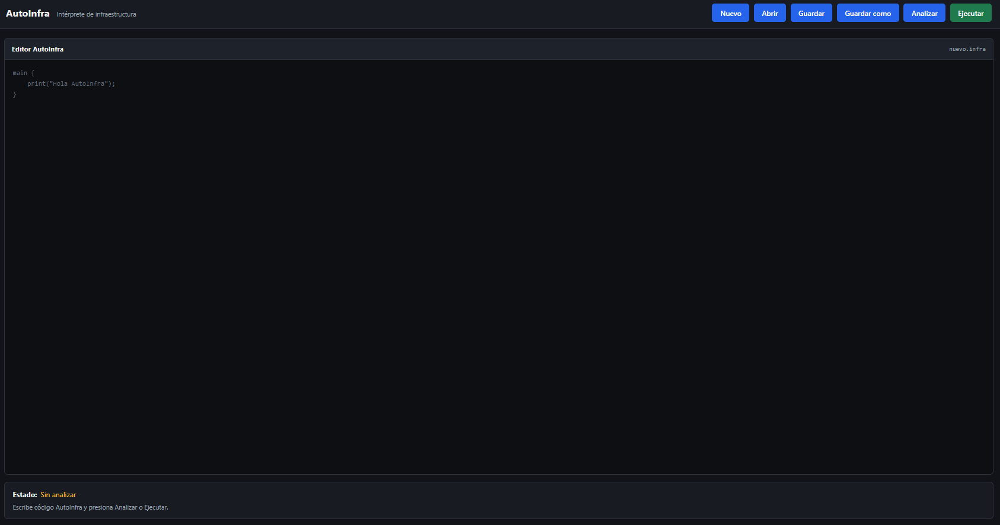

---

## 2. Requisitos para utilizar la aplicación

Para utilizar AutoInfra localmente se necesita:

- Node.js con npm instalado;
- un navegador web moderno;
- el proyecto AutoInfra con sus carpetas `Backend` y `Frontend`;
- dos terminales, una para ejecutar el Backend y otra para el Frontend.

Se recomienda Node.js 20.19 o superior (o 22.12 o superior), que es lo que exigen las dependencias del Frontend.

El Backend utiliza el puerto `3000` de acuerdo con su configuración actual. El Frontend se conecta a:

```text
http://localhost:3000/api/analyze   (Analizar)
http://localhost:3000/api/execute   (Ejecutar)
```

La dirección del Backend puede cambiarse con la variable `VITE_API_URL` en un archivo `.env` del Frontend.

---

## 3. Inicio de Backend y Frontend

### 3.1 Iniciar el Backend

Abra una terminal en la carpeta `Backend` e instale sus dependencias:

```bash
npm install
```

Después inicie el servidor:

```bash
npm run dev
```

El Backend debe quedar disponible en el puerto `3000`.

> Para utilizar la interfaz, el Backend debe permanecer encendido mientras se realizan análisis.

### 3.2 Iniciar el Frontend

Abra una segunda terminal en la carpeta `Frontend` e instale sus dependencias:

```bash
npm install
```

Después ejecute:

```bash
npm run dev
```

Vite mostrará en la terminal la dirección local del Frontend. Abra esa dirección en el navegador.

---

## 4. Vista general de la interfaz

La interfaz está organizada alrededor de tres áreas principales:

1. **Barra superior de acciones.** Muestra el nombre **AutoInfra**, el texto **Intérprete de infraestructura** y los botones `Nuevo`, `Abrir`, `Guardar`, `Guardar como`, `Analizar` y `Ejecutar`.
2. **Editor AutoInfra.** Contiene el código fuente y muestra el nombre del archivo actual en la parte superior del editor.
3. **Estado y resultados.** Debajo del editor se muestra el estado del análisis. Después de analizar aparecen el resumen, la tabla de errores, la tabla de tokens y la visualización del AST; después de ejecutar se agregan la consola, el estado final de infraestructura, la tabla de símbolos y la bitácora.

Mientras existe un análisis en curso, los botones de la barra superior permanecen deshabilitados y el botón de análisis muestra **Procesando...**.

---

## 5. Editor de código

El panel **Editor AutoInfra** es el área donde se escribe o modifica el código del archivo `.infra`.

Al iniciar la aplicación, el archivo se identifica como:

```text
nuevo.infra
```

El editor admite texto plano de AutoInfra y tiene la corrección ortográfica del navegador desactivada para evitar marcas propias de un editor de texto convencional.

Cuando el usuario modifica el contenido después de haber realizado un análisis:

- los resultados anteriores se ocultan inmediatamente;
- el estado vuelve a **Sin analizar**;
- cualquier mensaje de error de comunicación anterior desaparece.

Esto evita mostrar resultados que ya no correspondan al código visible en el editor.

---

## 6. Crear un archivo nuevo

Para comenzar un archivo vacío:

1. Presione **Nuevo**.
2. El editor se limpiará.
3. El nombre mostrado volverá a `nuevo.infra`.
4. El estado quedará como **Sin analizar**.
5. Cualquier resultado de un análisis anterior desaparecerá.


La captura muestra el botón **Nuevo** señalado con una flecha, mientras el editor aún contiene un archivo (`ArchivoPrueba.infra`). Al presionarlo, el editor queda vacío y el nombre vuelve a `nuevo.infra`.

> La opción **Nuevo** modifica el contenido actual del editor. Si desea conservar el contenido anterior, use **Guardar** o **Guardar como** antes de crear el nuevo archivo.

---

## 7. Abrir un archivo `.infra`

Para abrir un archivo existente:

1. Presione **Abrir**.
2. El navegador mostrará el selector de archivos.
3. Seleccione un archivo con extensión `.infra`.
4. Su contenido se cargará en el editor.
5. El nombre real del archivo aparecerá en el encabezado del editor.
6. El estado quedará como **Sin analizar** hasta presionar **Analizar**.

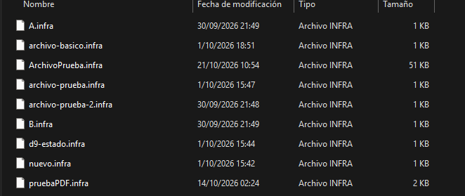

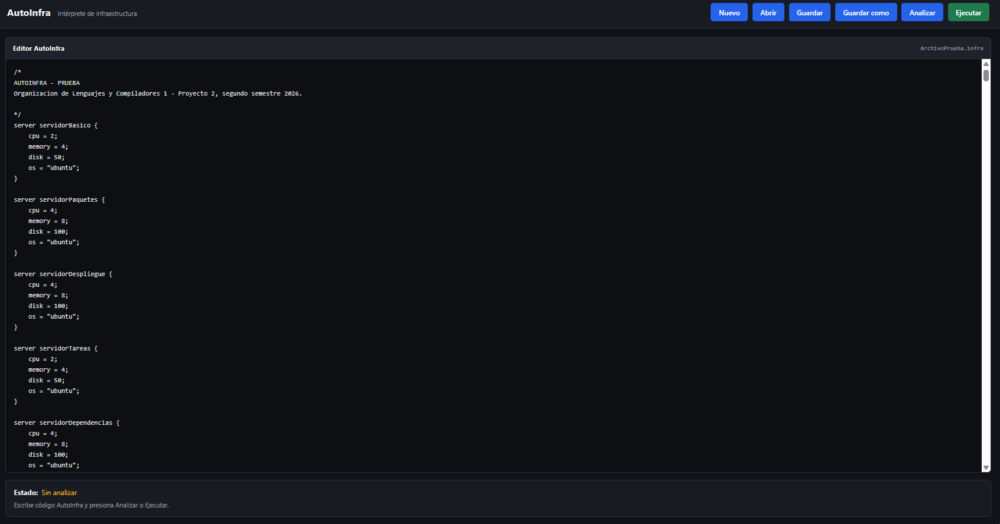

AutoInfra solo acepta archivos cuyo nombre termine en `.infra`. Si se intenta cargar otro tipo de archivo, la aplicación muestra el mensaje:

```text
Solo se pueden abrir archivos con extensión .infra.
```

Si se abre el selector y se cancela sin elegir un archivo, la aplicación conserva el contenido y estado actuales.

---

## 8. Guardar

El botón **Guardar** descarga el contenido actual del editor utilizando el nombre de archivo que se muestra en la interfaz.

Procedimiento:

1. Verifique el nombre actual mostrado en el editor.
2. Presione **Guardar**.
3. El navegador descargará una copia del contenido como archivo.

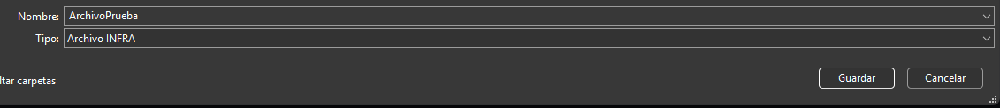

Según la configuración del navegador, puede mostrarse un cuadro como el de la captura para elegir la carpeta y confirmar el nombre (`ArchivoPrueba`, tipo **Archivo INFRA**); el archivo se guarda con extensión `.infra`.

### Comportamiento importante

**Guardar no sobrescribe físicamente el archivo original que fue abierto.** La aplicación crea una descarga desde el navegador con el nombre actual.

Guardar tampoco elimina ni invalida los resultados del análisis que estén visibles, porque no modifica el contenido del editor.

---

## 9. Guardar como

**Guardar como** permite descargar el contenido utilizando otro nombre.

1. Presione **Guardar como**.
2. Aparecerá el cuadro **Nombre del archivo:** con el nombre actual como valor inicial.
3. Escriba el nuevo nombre.
4. Confirme el cuadro.
5. La aplicación descargará el archivo.
6. El nuevo nombre quedará mostrado como nombre actual del archivo en la interfaz.

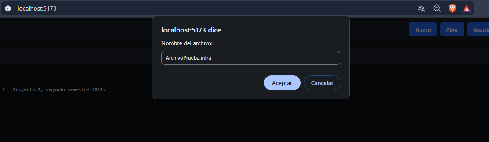

Si el nombre ingresado no termina en `.infra`, la aplicación agrega automáticamente la extensión.

Por ejemplo:

```text
configuracion
```

se normaliza como:

```text
configuracion.infra
```

Si se deja el nombre vacío, la aplicación muestra:

```text
El nombre del archivo no puede estar vacío.
```

Si se cancela el cuadro de nombre, no se realiza ninguna descarga ni se cambia el nombre actual.

---

## 10. Analizar código

Para analizar el código presente en el editor:

1. Asegúrese de que el Backend esté encendido.
2. Escriba o abra el código `.infra` que desea revisar.
3. Presione **Analizar**.
4. El estado cambia temporalmente a **Analizando** (o **Ejecutando**, si se presionó **Ejecutar**) y aparece el texto **Esperando respuesta del Backend.**
5. Los resultados anteriores se eliminan mientras se procesa la nueva solicitud.
6. Cuando el Backend responde correctamente, el estado cambia a **Análisis completado**.
7. Debajo aparecen los resultados correspondientes exclusivamente al código analizado en ese momento.

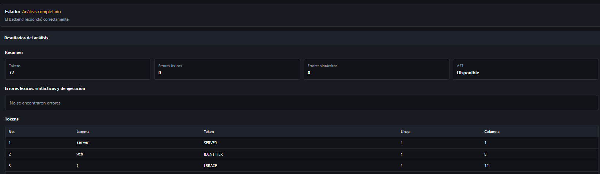

La captura corresponde al análisis de `examples/basico.infra`: el estado es **Análisis completado**, el **Resumen** indica 77 tokens, 0 errores léxicos, 0 errores sintácticos y AST disponible, la tabla de errores muestra `No se encontraron errores.` y debajo comienza la tabla de **Tokens**. Al analizar no se ejecuta el programa, por eso no aparecen la consola ni el estado de infraestructura.

### Ejecutar

Presione **Ejecutar** para analizar y ejecutar el programa:

1. El Backend realiza el análisis léxico y sintáctico y construye el AST.
2. Si existen errores sintácticos, **no se ejecuta** y se muestran todos los errores. Los errores léxicos (por ejemplo un carácter `@` aislado) se reportan, el carácter se descarta y la ejecución continúa.
3. Si no existen, se registran los recursos, funciones y tareas globales, y se ejecuta el bloque `main`.
4. La interfaz muestra la consola, el estado final de infraestructura, la tabla de símbolos, la bitácora y los reportes habituales.

Ejemplo (`start`, `deploy` y `scale` modifican el estado simulado):

```infra
server backend { cpu = 4; memory = 8; disk = 100; os = "ubuntu"; }
service api { port = 8080; replicas = 2; }

main {
    start(backend);
    deploy(backend, api);
    scale(api, 3);
    print("Réplicas: " + api.replicas);
}
```

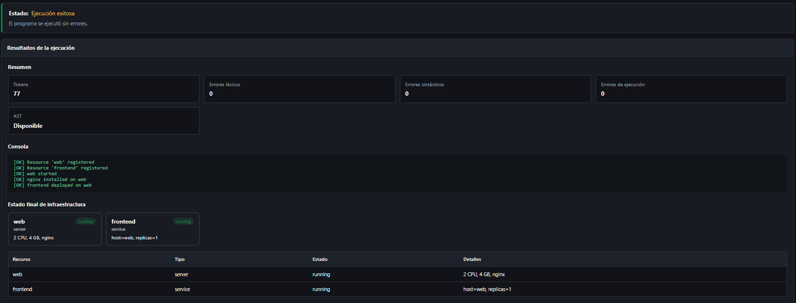

La captura corresponde a la ejecución de `examples/basico.infra`: el estado es **Ejecución exitosa**, el **Resumen** indica 0 errores léxicos, sintácticos y de ejecución, y debajo aparecen la **Consola** y el **Estado final de infraestructura**.

El estado de la ejecución puede ser **Ejecución exitosa** (sin errores), **Ejecución con errores** (errores de ejecución o de infraestructura, por ejemplo `INFRA-004` cuando se despliega un servicio cuya dependencia no está en `running`), **Ejecución completada con errores léxicos** (se descartaron caracteres no reconocidos y el programa continuó) o **Ejecución no realizada** (el programa tenía errores sintácticos). Los programas de ejemplo están en la carpeta `examples/` (ver sección 17).

---

## 11. Estado y resumen del análisis

El panel de estado puede presentar las siguientes situaciones:

| Estado | Significado |
|---|---|
| **Sin analizar** | El código actual todavía no tiene resultados vigentes. |
| **Analizando / Ejecutando** | El Frontend está esperando la respuesta del Backend. |
| **Análisis completado** | El Backend respondió correctamente y existen resultados para mostrar. |
| **Ejecución exitosa** | El programa se ejecutó sin errores. |
| **Ejecución con errores** | Hubo errores de ejecución o de infraestructura (por ejemplo `INFRA-004`). |
| **Ejecución completada con errores léxicos** | Se descartaron caracteres no reconocidos y el programa continuó. |
| **Ejecución no realizada** | El programa contiene errores sintácticos. |
| **Error de comunicación** | La solicitud no pudo completarse correctamente. |

Un análisis puede figurar como **Análisis completado** y al mismo tiempo contener errores léxicos o sintácticos. Del mismo modo, si el código tiene errores sintácticos y se presiona **Ejecutar**, el estado será **Ejecución no realizada**, pero todos los errores se muestran igualmente. Esto significa que el Backend terminó correctamente el proceso de análisis; los errores del código se consultan en el reporte correspondiente.

### Resumen

Después de una respuesta válida aparece el apartado **Resumen**, con estos valores (más **Errores de ejecución** cuando se ejecutó):

- **Tokens:** cantidad de tokens reportados;
- **Errores léxicos:** cantidad detectada;
- **Errores sintácticos:** cantidad detectada;
- **Errores de ejecución:** solo aparece cuando se ejecutó el programa;
- **AST:** `Disponible` o `No disponible`.

Los valores corresponden únicamente al análisis actual.

---

## 12. Tabla de errores

El apartado **Errores léxicos, sintácticos y de ejecución** presenta los problemas detectados durante el análisis y, si el programa se ejecutó, durante la ejecución.

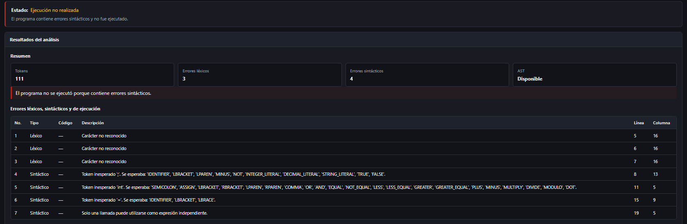

La captura corresponde a `examples/errores_mixtos.infra`: el estado es **Ejecución no realizada** (hay errores sintácticos), el **Resumen** cuenta 3 errores léxicos y 4 sintácticos, y la tabla los lista a todos con su línea y columna.

La tabla muestra:

| Columna | Contenido |
|---|---|
| **No.** | Número de fila del reporte. |
| **Tipo** | `Léxico`, `Sintáctico`, `Ejecución` o `Infraestructura`. |
| **Código** | Código del error cuando existe. Solo `INFRA-004` (dependencia no activa al desplegar) tiene código; en los demás casos se muestra `—`. |
| **Descripción** | Explicación del error detectado. |
| **Línea** | Línea donde se reportó el problema. |
| **Columna** | Columna donde se reportó el problema. |

Si no existen errores, la aplicación muestra:

```text
No se encontraron errores.
```

### Ejemplo para observar errores

Puede utilizar un archivo como:

```infra
main {
    int x = ;
    @
    print("continua");
}
```

Este ejemplo permite observar un error sintáctico y un carácter no reconocido reportado como error léxico. El archivo `examples/errores_mixtos.infra` contiene 3 errores léxicos y 4 sintácticos en un mismo programa. El objetivo del reporte es mostrar la ubicación de los problemas y permitir que el usuario corrija el código antes de volver a analizarlo.

---

## 13. Tabla de tokens

El apartado **Tokens** muestra los elementos léxicos reconocidos en el código fuente.

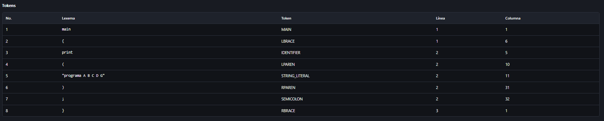

La captura muestra los tokens de un programa mínimo: `main { print("programa A B C D G"); }`.

Las columnas son:

| Columna | Contenido |
|---|---|
| **No.** | Número de fila. |
| **Lexema** | Texto que apareció en el archivo. |
| **Token** | Categoría reconocida por el analizador. |
| **Línea** | Línea del lexema. |
| **Columna** | Columna inicial del lexema. |

La tabla respeta el orden en que los tokens fueron reconocidos en el archivo.

Si no existen tokens para mostrar, aparece:

```text
No se encontraron tokens.
```

---

## 14. Visualización gráfica del AST

El apartado **Árbol de sintaxis abstracta** muestra una representación gráfica del AST generado por el Backend.

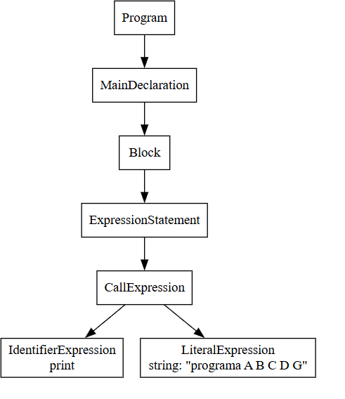

La captura corresponde al mismo programa mínimo: `Program` → `MainDeclaration` → `Block` → `ExpressionStatement` → `CallExpression`, con el identificador `print` y el literal de texto como hijos.

El Frontend recibe el SVG ya generado por el Backend y lo muestra dentro de un área desplazable. El navegador no reconstruye por su cuenta la estructura del árbol.

El gráfico representa la estructura sintáctica del programa, por ejemplo declaraciones, bloques, expresiones y llamadas reconocidas por el parser.

Si el análisis no produce un AST disponible, la interfaz muestra:

```text
No hay un AST disponible para este análisis.
```

---

## 15. Resultados de la ejecución

Al presionar **Ejecutar** (y cuando el programa no tiene errores sintácticos), el panel de resultados agrega las siguientes secciones, en este orden: **Consola**, **Estado final de infraestructura**, **Errores**, **Tabla de símbolos**, **Bitácora**, **Tokens** y **Árbol de sintaxis abstracta**.

### 15.1 Consola

Muestra, en orden de ocurrencia, lo escrito con `print` y las entradas de la bitácora. Las líneas `[OK]` se muestran en verde, `[FAIL]` en ámbar y `[ERROR]` en rojo. Ejemplo (`examples/integral.infra`):

```text
[OK] Resource 'backend' registered
[OK] Resource 'postgres' registered
[OK] Resource 'api' registered
[OK] postgres started
[OK] backend started
[OK] docker installed on backend
[OK] git installed on backend
[OK] api deployed on backend
[OK] api scaled to 3 replicas
API disponible en puerto 8080
Servidor: ubuntu
Réplicas: 3
```

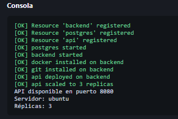

La captura corresponde a `examples/integral.infra`: las líneas `[OK]` provienen de la bitácora y las tres últimas, de `print`.

### 15.2 Estado final de infraestructura

Presenta cada recurso declarado como una tarjeta (nombre, estado, tipo y detalles) y como una tabla con las columnas **Recurso**, **Tipo**, **Estado** y **Detalles**:

| Tipo | Detalles mostrados |
|---|---|
| `server` | CPU, memoria (GB) y paquetes instalados, por ejemplo `4 CPU, 8 GB, docker`. |
| `database` | Motor, versión y puerto, por ejemplo `postgresql 16 :5432`. |
| `service` | Servidor donde está desplegado y réplicas, por ejemplo `host=backend, replicas=3`. |

Si hay conexiones registradas con `connect`, se agregan como `connected: ...`. Los estados iniciales son `stopped` (server y database) y `undeployed` (service); las acciones nativas los cambian a `running`, `stopped`, etc.

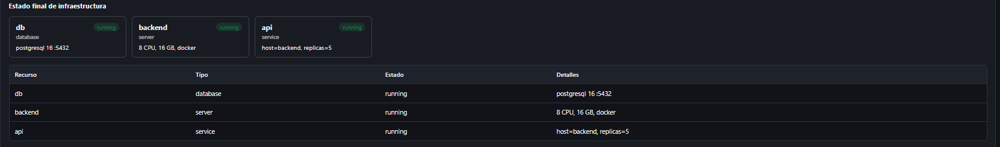

La captura corresponde a `examples/avanzado.infra`: `db` (database), `backend` (server con `docker`) y `api` (service desplegado en `backend` con 5 réplicas), todos en `running`.

### 15.3 Tabla de símbolos

Lista las declaraciones ejecutadas con las columnas **Identificador**, **Categoría** (`variable`, `parámetro`, `recurso`, `función` o `task`), **Tipo**, **Ámbito**, **Valor / Estado**, **Línea** y **Columna**. El valor corresponde al **estado final**: el último valor asignado a una variable o el estado de un recurso. El ámbito es `global`, el nombre de la función o task, `main`, o un bloque anidado (por ejemplo `main > for > cuerpo`).

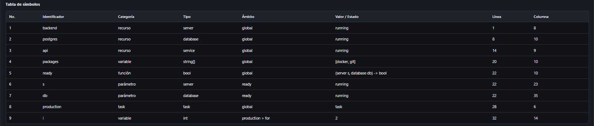

La captura corresponde a `examples/integral.infra`: incluye los recursos, la variable global `packages`, la función `ready` con sus parámetros `s` y `db`, la task `production` y la variable `i` del `for`, con su ámbito (`production > for`) y su valor final.

### 15.4 Bitácora

Registra cada acción de infraestructura con las columnas **No.**, **Nivel** (`OK`, `FAIL` o `ERROR`), **Mensaje**, **Línea** y **Columna**. `FAIL` indica una acción que no pudo realizarse y devolvió `false` (por ejemplo `stop` sobre un recurso ya detenido).

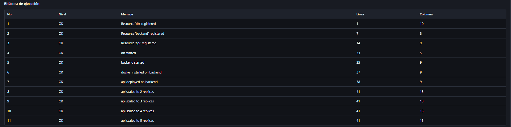

La captura corresponde a `examples/avanzado.infra`: primero el registro de los tres recursos y luego las acciones en orden, incluidas las cuatro llamadas a `scale` del ciclo `for` (de 2 a 5 réplicas).

### 15.5 Errores de ejecución y de infraestructura

- **Infraestructura (`INFRA-004`):** `deploy` exige que todas las dependencias del servicio (`dependsOn`) existan y estén en `running`. Si no, se registra el error con su línea y columna, `deploy` devuelve `false`, no se modifica ningún recurso y la ejecución continúa.
- **Ejecución:** errores como un identificador no definido, un índice de arreglo fuera de rango o una task inexistente detienen la ejecución en ese punto. Lo ejecutado hasta ese momento permanece visible en la consola, la bitácora y el estado de infraestructura.

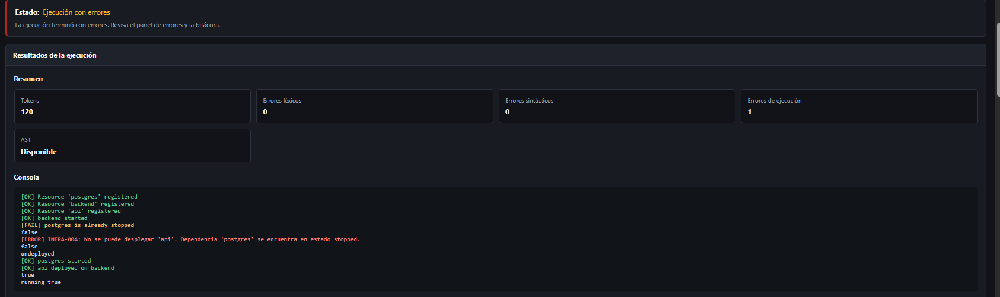

La captura corresponde a `examples/error_dependencia.infra`: el estado es **Ejecución con errores** y el **Resumen** cuenta 1 error de ejecución. En la **Consola**, `stop` sobre `postgres` (ya detenido) muestra `[FAIL]` y devuelve `false`; el primer `deploy` de `api` muestra `[ERROR] INFRA-004` porque `postgres` está `stopped`, devuelve `false` y deja `api` como `undeployed`; después de `start(postgres)`, el segundo `deploy` se realiza (`[OK] api deployed on backend`). El mismo error aparece en la tabla de errores con su línea y columna.

---

## 16. Ejemplo completo de uso

El siguiente ejemplo permite recorrer el flujo normal de la aplicación:

```infra
main {
    int numero = 25;
    print("Valor: " + numero);
}
```

### Paso 1 — Crear o abrir el archivo

Presione **Nuevo** y escriba el ejemplo en el editor, o guárdelo previamente como un archivo `.infra` y ábralo mediante **Abrir**.

### Paso 2 — Guardar el código

Puede utilizar **Guardar** para descargarlo con el nombre actual, o **Guardar como** para asignarle un nombre como:

```text
ejemplo.infra
```

### Paso 3 — Analizar

Presione **Analizar** (solo análisis) o **Ejecutar** (análisis y ejecución).

Durante la solicitud, el estado será **Analizando** o **Ejecutando**. Después de una respuesta correcta pasará a **Análisis completado** o **Ejecución exitosa**. Al ejecutar este ejemplo, la consola muestra `Valor: 25`.

### Paso 4 — Revisar el resumen

Compruebe:

- cantidad de tokens;
- cero errores léxicos si el código fue copiado correctamente;
- cero errores sintácticos si el código fue copiado correctamente;
- disponibilidad del AST.

### Paso 5 — Revisar reportes

Desplácese por la consola (al ejecutar), **Errores**, **Tabla de símbolos**, **Bitácora**, **Tokens** y **Árbol de sintaxis abstracta**.

Las capturas de las secciones anteriores y de la sección 15 muestran los mismos tipos de resultados que deben revisarse en este flujo.

---

## 17. Programas de ejemplo

La carpeta `examples/` incluye programas listos para abrir con **Abrir** y ejecutar con **Ejecutar**:

| Archivo | Qué demuestra | Resultado esperado |
|---|---|---|
| `basico.infra` | Recursos, variables, `if`, `install`, `deploy`. | `web` y `frontend` en `running`; `nginx` instalado. |
| `intermedio.infra` | Arreglos, `while`, funciones, `task` y `run`. | `node` en `running` con `docker`, `git` y `nginx`. |
| `avanzado.infra` | `dependsOn`, recursión, `for`, `scale`. | `api` en `running` con 5 réplicas sobre `backend`. |
| `integral.infra` | Ejemplo integral del enunciado (sección 30). | Imprime puerto, sistema operativo del servidor y réplicas. |
| `programa_completo.infra` | Programa completo del enunciado (sección 15.2). | `api` desplegada con 3 réplicas. |
| `error_dependencia.infra` | `INFRA-004`. | **Ejecución con errores**; `api` no se despliega mientras `postgres` está detenido. |
| `errores_mixtos.infra` | 3 errores léxicos y 4 sintácticos juntos. | **Ejecución no realizada**; se listan los 7 errores. |
| `ArchivoPrueba.infra` | Archivo de prueba del auxiliar. | 3 errores léxicos (`@`), 0 sintácticos; se ejecuta y obtiene `PUNTAJE AUTOMATICO: 79.0/79`. |

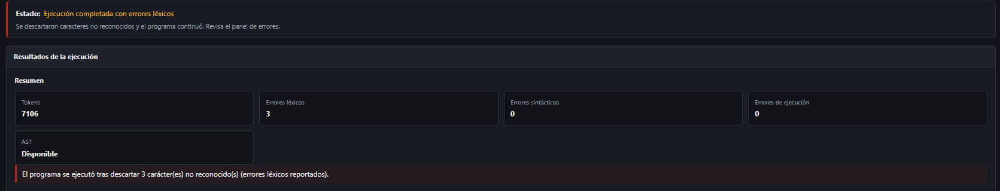

La captura corresponde a `examples/ArchivoPrueba.infra`: el estado es **Ejecución completada con errores léxicos**, el **Resumen** cuenta 3 errores léxicos, 0 sintácticos y 0 de ejecución, y el aviso indica que se descartaron 3 caracteres no reconocidos y el programa continuó.

---

## 18. Reportes disponibles

La aplicación ofrece los siguientes reportes al usuario:

| Reporte | Información mostrada |
|---|---|
| **Errores** | Tipo (léxico, sintáctico, de ejecución o de infraestructura), código (por ejemplo `INFRA-004`), descripción, línea y columna. |
| **Tokens** | Lexema, categoría del token, línea y columna. |
| **AST gráfico** | Representación SVG del árbol de sintaxis abstracta generado por el Backend. |
| **Tabla de símbolos** *(al ejecutar)* | Identificador, categoría (variable, parámetro, recurso, función, task), tipo, ámbito, valor/estado final, línea y columna. |
| **Estado final de infraestructura** *(al ejecutar)* | Tarjetas y tabla con recurso, tipo, estado y detalles (CPU, memoria, paquetes, host, réplicas, conexiones). |
| **Bitácora** *(al ejecutar)* | Acciones realizadas, con nivel `OK`, `FAIL` o `ERROR`, línea y columna. |
| **Consola** *(al ejecutar)* | Salida de `print` y de la bitácora, en orden. |

El panel **Resumen** complementa estos reportes mostrando sus cantidades principales y la disponibilidad del AST.

---

## 19. Errores y situaciones comunes

### 19.1 El Backend no está disponible

Si el Frontend no puede completar la petición, el estado cambia a **Error de comunicación** y se muestra el mensaje correspondiente (por ejemplo `Failed to fetch` cuando el Backend está apagado).

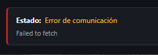

Para resolverlo:

1. compruebe que la terminal del Backend siga abierta;
2. compruebe que se haya ejecutado `npm run dev` en `Backend`;
3. compruebe que el Backend esté usando el puerto `3000`;
4. vuelva a presionar **Analizar** una vez restablecido el servicio.

No es necesario recargar el Frontend para volver a intentar el análisis.

### 19.2 El código contiene errores

Que el estado muestre **Análisis completado** no significa necesariamente que el código no contenga errores. Consulte:

- el contador de errores del resumen;
- la tabla **Errores léxicos, sintácticos y de ejecución**;
- las columnas de línea y columna.

Corrija el código y vuelva a presionar **Analizar**.

### 19.3 Los resultados desaparecen al editar

Es el comportamiento esperado. Cualquier modificación del código invalida el análisis previo y devuelve la aplicación al estado **Sin analizar**.

### 19.4 No se puede abrir un archivo

Verifique que su extensión sea `.infra`. La aplicación rechaza otros tipos de archivo.

### 19.5 Guardar no modifica el archivo original

Es el comportamiento esperado. **Guardar** y **Guardar como** producen una descarga mediante el navegador. Si abrió un archivo existente y luego lo editó, guardar crea una nueva descarga; no escribe directamente sobre el archivo original del sistema.

### 19.6 El programa no se ejecuta

Si al presionar **Ejecutar** aparece **Ejecución no realizada**, el código contiene errores sintácticos. Corríjalos (se listan en la tabla de errores) y vuelva a ejecutar.

### 19.7 No aparece el AST

El AST solo se muestra cuando el Backend entrega un SVG para el análisis actual. Si no está disponible, la interfaz muestra el mensaje correspondiente en el apartado del árbol.

---
